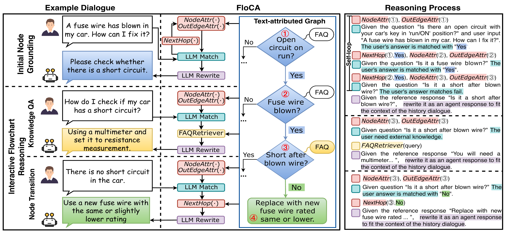

# FloCA: Towards Faithful and Logically Consistent Flowchart Reasoning

<p align="center">
  <a href="https://2026.emnlp.org/"></a>
  
  
  
  <a href="https://github.com/Jinzi-Zou/FloCA-flowchart-reasoning/stargazers"></a>
</p>

<p align="center">
  <a href="#overview">Overview</a> &bull;
  <a href="#installation">Installation</a> &bull;
  <a href="#data-preparation">Data</a> &bull;
  <a href="#running-flodial">FLODIAL</a> &bull;
  <a href="#running-pfdial">PFDial</a> &bull;
  <a href="#citation">Citation</a>
</p>

Official implementation of **"FloCA: Towards Faithful and Logically Consistent Flowchart Reasoning"**, accepted at **EMNLP 2026**.

**Authors:** Jinzi Zou, Bolin Wang, Shuo Zhang, Nuo Xu, and Junzhou Zhao

**Repository:** [Jinzi-Zou/FloCA-flowchart-reasoning](https://github.com/Jinzi-Zou/FloCA-flowchart-reasoning)

<p align="center">
  
</p>

<p align="center">
  <em>FloCA delegates topology-constrained graph execution to a flowchart reasoning tool while using an LLM for language understanding and response generation.</em>
</p>

## Overview

Flowchart-oriented dialogue (FOD) systems guide users through multi-turn decision-making or operational procedures by following a domain specific flowchart. Existing LLM- and VLM-based approaches often represent flowcharts as text or images and rely on probabilistic generation for reasoning. As a result, they can produce semantically plausible but topologically invalid node transitions.

We introduce **FloCA**, a zero-shot **Flo**wchart-oriented **C**onversational **A**gent that separates language understanding from flowchart execution. FloCA uses an LLM for intent understanding, semantic edge matching, and response generation, while an external reasoning tool performs topology-constrained graph execution. This design preserves the current node state and guarantees that every executed transition follows the flowchart topology.

FloCA is evaluated on **FLODIAL** and **PFDial**. The experiments show that topology-constrained execution improves task success, logical consistency, and interaction efficiency over RAG-based, graph-serialization, VLM-based, and supervised fine-tuning baselines.

## Highlights

- We formally define the **Flowchart-Oriented Dialogue** task, which requires both context-aware response generation and topology-consistent flowchart reasoning.
- We propose **FloCA**, a zero-shot conversational agent with a deterministic flowchart reasoning tool.
- FloCA supports initial-node grounding, multi-turn graph execution, and recovery from domain-knowledge QA interruptions.
- We introduce an LLM-based user simulator and five metrics for reasoning accuracy and interaction efficiency.
- We provide experiments on the English troubleshooting dataset FLODIAL and the Chinese PlantUML-based dataset PFDial.

## Method

FloCA represents each flowchart as a text-attributed graph and exposes four graph operations:

- `NodeAttr(node_id)`: returns the textual attribute of a node.
- `OutEdgeAttr(node_id)`: returns the attributes of all outgoing edges.
- `NextHop(node_id, edge_attr)`: follows a valid outgoing edge to its target node.
- `TerminalCheck(node_id)`: determines whether the current node is terminal.

At each dialogue turn, the LLM interprets the user utterance and matches it to an outgoing transition condition. The graph tool then executes the transition. If the user asks a domain-knowledge question, FloCA preserves the current node, answers the question using the available FAQ knowledge, and resumes reasoning from the same state.

## Repository Structure

```text
.
|-- FloDial/
|   |-- baseline_agent.py          # Main entry point for FLODIAL experiments
|   |-- agent_tool.py              # Flowchart/tool selection
|   |-- agent_node_location.py     # Initial grounding and node transitions
|   |-- agent_chat.py              # Response generation
|   |-- agent_qa.py                # Domain-knowledge QA
|   |-- user.py                    # LLM-based user simulator
|   |-- datasets.py                # Graph dataset representation
|   |-- utils.py                   # Data loading and shared utilities
|   `-- FloDial-dataset/           # FLODIAL dialogues and knowledge sources
|-- PFDial/
|   |-- baseline_agent.py          # Main entry point for PFDial experiments
|   |-- agent_node_location.py     # Node grounding and transitions
|   |-- agent_chat.py              # Response generation
|   |-- user.py                    # LLM-based user simulator
|   |-- datasets.py                # Graph dataset representation
|   |-- utils.py                   # Data loading and shared utilities
|   |-- PFDial_datasets/           # Processed ID/OOD flowcharts and dialogues
|   `-- PFDial-Raw_Data/           # Original PFDial-format data
|-- assets/
|   `-- floca_overview.png          # Overview of the FloCA framework
|-- requirements.txt
`-- README.md
```

## Installation

The code was tested with Python 3.9.21, PyTorch 2.4.1, and CUDA 12.1.

```bash
conda create -n floca python=3.9.21 -y
conda activate floca
pip install -r requirements.txt
```

For a CUDA 12.1 environment, PyTorch can be installed explicitly before the remaining dependencies:

```bash
pip install torch==2.4.1 --index-url https://download.pytorch.org/whl/cu121
pip install -r requirements.txt
```

## Data Preparation

The expected data layout is:

```text
FloDial/FloDial-dataset/
|-- dialogs/
|   |-- dialogs.json
|   |-- test_dialogs.json
|   |-- s-flo.json
|   `-- s-flo-test.json
`-- knowledge-sources/
    |-- *.json
    `-- *.gif

PFDial/PFDial_datasets/
|-- dialog/
|   |-- annotated_dialog_test_id_formatA(main).json
|   `-- annotated_dialog_test_ood_formatA(main).json
`-- flowchart/
    |-- flowchart_test_id_formatA(main).json
    `-- flowchart_test_ood_formatA(main).json
```

FLODIAL contains troubleshooting flowcharts for cars and laptops. PFDial contains Chinese PlantUML-based flowcharts. For the FOD evaluation in our paper, complete multi-turn PFDial dialogues are constructed from extracted flowchart paths and annotated with ground-truth node IDs.

Please follow the licenses and terms of use of the original FLODIAL and PFDial datasets when redistributing their data.

## API Keys

API keys are read from environment variables and must not be committed to the repository.

```bash
export MODEL_API_KEY="your-model-provider-api-key"
export DEEPSEEK_API_KEY="your-deepseek-api-key"
```

- `MODEL_API_KEY` is used by the evaluated conversational agent.
- `DEEPSEEK_API_KEY` is used by the DeepSeek-based user simulator.

When DeepSeek is used for both components, the two variables may contain the same key.

## Supported Model Backends

The current implementation supports the following backends:

| Backend | Example `--model-name` | Notes |
|---|---|---|
| DeepSeek API | `deepseek-reasoner` | Requires `MODEL_API_KEY` |
| OpenRouter/OpenAI-compatible API | `openai/gpt-4o`, `openai/gpt-5`, `anthropic/claude-opus-4.1` | FLODIAL accepts `--openrouter-base-url`; PFDial uses the configured OpenRouter URL |
| DashScope | `qwen-plus` | Requires `MODEL_API_KEY` |
| Local Hugging Face model (PFDial) | `Llama-3.1-8B-Instruct`, `Qwen2.5-7B-Instruct` | Load from `PFDial/models/<model-name>` |
| Ollama | Any other Ollama model name | The Ollama service and model must be available locally |

## Running FLODIAL

Run commands from the `FloDial` directory so that the default relative paths resolve correctly.

### DeepSeek

```bash
cd FloDial

python baseline_agent.py \
  --model-name deepseek-reasoner \
  --flowchart-dir ./FloDial-dataset/knowledge-sources/ \
  --dialog-dir ./FloDial-dataset/dialogs/ \
  --checkpoint 0
```

### OpenRouter

```bash
cd FloDial

python baseline_agent.py \
  --model-name openai/gpt-5 \
  --openrouter-base-url https://openrouter.ai/api/v1 \
  --flowchart-dir ./FloDial-dataset/knowledge-sources/ \
  --dialog-dir ./FloDial-dataset/dialogs/ \
  --checkpoint 0
```

## Running PFDial

Run commands from the `PFDial` directory.

### In-domain evaluation

```bash
cd PFDial

python baseline_agent.py \
  --model-name deepseek-reasoner \
  --flowchart-dir './PFDial_datasets/flowchart/flowchart_test_id_formatA(main).json' \
  --dialog-dir './PFDial_datasets/dialog/annotated_dialog_test_id_formatA(main).json' \
  --checkpoint 0
```

### Out-of-domain evaluation

```bash
cd PFDial

python baseline_agent.py \
  --model-name deepseek-reasoner \
  --flowchart-dir './PFDial_datasets/flowchart/flowchart_test_ood_formatA(main).json' \
  --dialog-dir './PFDial_datasets/dialog/annotated_dialog_test_ood_formatA(main).json' \
  --checkpoint 0
```

### Local Hugging Face models

Place a downloaded model under the following directory:

```text
PFDial/models/Llama-3.1-8B-Instruct/
```

Then run:

```bash
cd PFDial

python baseline_agent.py \
  --model-name Llama-3.1-8B-Instruct \
  --flowchart-dir './PFDial_datasets/flowchart/flowchart_test_id_formatA(main).json' \
  --dialog-dir './PFDial_datasets/dialog/annotated_dialog_test_id_formatA(main).json' \
  --checkpoint 0
```

The DeepSeek user simulator still requires `DEEPSEEK_API_KEY` when a local model is used for the agent.

## Arguments

| Argument | Description |
|---|---|
| `--model-name` | Model identifier used by the conversational agent |
| `--flowchart-dir` | FLODIAL knowledge-source directory or PFDial flowchart JSON file |
| `--dialog-dir` | Dialogue directory for FLODIAL or dialogue JSON file for PFDial |
| `--checkpoint` | Resume from the specified shuffled-dialogue index; defaults to `0` |
| `--openrouter-base-url` | OpenAI-compatible endpoint used by the FLODIAL entry point |

## Outputs

Prediction files are updated after each completed dialogue.

FLODIAL:

```text
FloDial/results/<model-name>/pre_test_dialogs_<model-name>_<checkpoint>.json
```

PFDial:

```text
PFDial/results/<model-name>/pfdial_pre_test_dialogs_<model-name>_<checkpoint>.json
```

FLODIAL converts `/` in model identifiers to `_` when constructing output paths. PFDial converts both `/` and `:` to `_`.

## Evaluation Metrics

The paper evaluates flowchart reasoning from three perspectives:

- **Initial Node Grounding Accuracy (INGA):** correctness of the initially grounded node.
- **Terminal Node Grounding Accuracy (TNGA):** correctness of the reached terminal node.
- **Path Coverage Accuracy (PCA):** whether the predicted path covers all ground-truth nodes in order.
- **Timeout Rate (TR):** proportion of dialogues that exceed the turn budget.
- **Node Stay Redundancy (NSR):** proportion of redundant turns spent at the same node.

The turn budget used by the released entry points is twice the number of turns in the corresponding ground-truth dialogue.

## Main Results

The following results are reported in the paper; all values are percentages.

| Dataset and setting | FloCA backbone | INGA | TNGA | PCA | TR | NSR |
|---|---:|---:|---:|---:|---:|---:|
| FLODIAL, in-domain | GPT-5 | 61.45 | 91.92 | 90.88 | 0.00 | 0.60 |
| PFDial, in-domain | DeepSeek-R1 | 100.00 | 98.30 | 94.33 | 0.00 | 0.60 |
| PFDial, out-of-domain | DeepSeek-R1 | 100.00 | 97.83 | 83.41 | 0.00 | 1.02 |

For FLODIAL, the reported INGA value is the overall score combining root-initialized and middle-initialized samples.

## Limitations

The current implementation assumes forward progression through a flowchart and does not explicitly support backward transitions or state correction. Semantic edge matching still depends on the language understanding ability of the selected backbone model. Please refer to the paper for the complete discussion.

## Citation

If you find this work useful, please cite:

```bibtex
@article{zou2026floca,
  title={FloCA: Towards Faithful and Logically Consistent Flowchart Reasoning},
  author={Zou, Jinzi and Wang, Bolin and Zhang, Shuo and Xu, Nuo and Zhao, Junzhou},
  journal={arXiv preprint arXiv:2602.14035},
  year={2026}
}
```

## Acknowledgements

We thank the authors of FLODIAL, PFDial, and the open-source model and tooling communities on which this work builds.

## License

Code and dataset licensing information should be provided in a separate `LICENSE` file. Dataset redistribution remains subject to the licenses of the original FLODIAL and PFDial resources.
